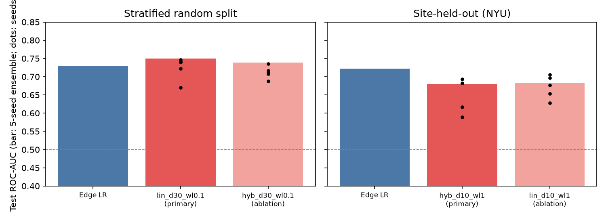
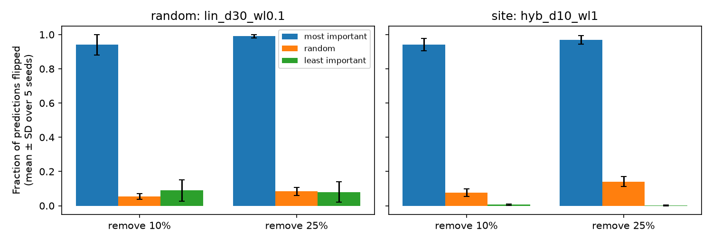

# Which Connections Matter? Faithful, reproducible edge explanations for autism classification on ABIDE

Date: 2026-11-09 · Code: `scripts/`, `src/` · Main results: `results/full/final_v3/` (test fold 1 of 5) and `results/full/final_v3_f1/` (confirmation, disjoint test fold 2 of 5)

## Abstract

We classify autism spectrum disorder (ASD) vs typical controls (TC) from resting-state functional connectivity in 817 ABIDE I subjects from 20 sites, and ask which connections drive the predictions. We use an explainable graph model in which every subject-specific contribution flows through the graph's edges, so that GNNExplainer edge masks can be tested by removing edges. On held-out data the model performs on par with a strong logistic-regression (LR) baseline (test AUC 0.67–0.75 vs 0.67–0.73), including on unseen sites (0.68–0.69 vs 0.69–0.72). Its explanations are (i) **faithful**: removing the 10% most important edges flips 93–98% of predictions, vs 5–8% for random edges; (ii) **reproducible**: edge rankings agree across training seeds and across disjoint train/test data (Spearman ≈ 0.43 between independent replications); and (iii) **convergent with group-level statistics**: the top-100 explained edges are 2.6–4.2× enriched for edges that differ significantly between ASD and TC (hypergeometric p = 2e-4 to 8e-16). Group-level analysis shows widespread ASD hypoconnectivity (360 edges, FDR 5%), centred on the right middle temporal pole and orbitofrontal–temporal connections. All findings replicate on a second, disjoint test set. The message-passing (GNN) component itself did not add predictive value over the edge-level path (Section 4.3).

## 1. Data

- ABIDE I, Preprocessed Connectomes Project, C-PAC, band-pass filtered without global signal regression (`filt_noglobal`), AAL-116 ROI time series, quality-checked subjects (nilearn `quality_checked=True`).
- 817 subjects after excluding 6 with constant ROI signals: 377 ASD / 440 TC, 20 sites.
- Connectivity: Pearson correlation per subject; graph = strongest 10% or 30% absolute correlations (undirected). ROI names come from the AAL SPM12 atlas; the PCP `.1D` column order (ascending AAL codes) was checked to match.

## 2. Methods

### 2.1 Evaluation design
- 5-fold partitions of the subjects, of which we use one fold as the test set (20%):
  - **Random:** stratified by diagnosis.
  - **Site-held-out:** stratified and grouped by site, so test sites are never seen in training.
- **Main test set:** fold 1. Random: 164 subjects. Site-held-out: NYU, 167 subjects.
- **Confirmation test set:** fold 2, disjoint from fold 1. Random: 164 new subjects. Site-held-out: five new sites (CALTECH, LEUVEN_1, STANFORD, TRINITY, USM), 175 subjects.
- **Model configuration** was chosen by 3-fold CV inside the training portion only (grouped by site for the site scheme). Early stopping uses a 15% validation split of the training portion.
- Each model is trained with **5 random seeds**. We report the per-seed mean ± SD and a **5-seed ensemble** (mean probability). The ensemble and the analysis plan were fixed before the test results were examined.
- **95% CIs:** bootstrap over test subjects (2,000 resamples), paired when comparing models.

### 2.2 Models
- **Edge LR (baseline):** StandardScaler + L2 logistic regression on all 6,670 correlations; C chosen by inner 3-fold CV on train.
- **Site-only LR (confound check):** one-hot site label.
- **Explainable graph model** (`src/models.py`):
  - logit = b + Σ_edges W[u,v]·z_uv (+ an optional edge-only GNN).
  - z_uv is the Fisher-z correlation of the edge, standardised with training-set statistics.
  - W is a symmetric ROI × ROI weight matrix, implemented as a message-passing layer so that GNNExplainer's edge mask gates it.
  - The optional GNN part has two GraphConv layers on signed edge weights, with a learnable ROI embedding as the only node feature, followed by mean pooling.
  - In this design, all subject-specific information enters through the edges, so deleting an edge really deletes information. Earlier versions with correlation-profile node features did not have this property (see Appendix A).
- **Selected configurations** (inner CV; LR reference on the same folds = 0.684 / 0.685):
  - random scheme: `lin_d30_wl0.1`, i.e. edge-linear path only, 30% density, edge-weight decay 0.1 (inner AUC 0.656);
  - site scheme: `hyb_d10_wl1`, i.e. edge-linear path + GNN, 10% density, edge-weight decay 1 (inner AUC 0.637).
  - The top configurations differed by ≤ 0.02 (within noise).

### 2.3 Explanations
- **Method:** GNNExplainer (PyG), 100 epochs, edge mask only, computed for every test graph. The two directions of each undirected edge are averaged.
- **Fidelity (necessity):**
  - remove the 10% or 25% highest-mask, lowest-mask, or randomly chosen edges of each test graph;
  - measure the drop in the confidence of the originally predicted class, and the fraction of predictions that flip.
- **Reproducibility:** pairwise agreement of the mean edge masks
  - across the 5 seeds;
  - between the two disjoint test folds (different training data, different test subjects).
- **Convergence:** overlap of the top-100 edges (by seed-averaged mask) with edges that differ significantly between groups.
  - Group differences come from Welch t-tests on site-centred Fisher-z values, BH-FDR 5%.
  - Enrichment is tested against the base rate **among the edges the explainer could score**, using a hypergeometric test.

## 3. Results

### 3.1 Prediction

| Test set | Model | AUC, 5-seed ensemble [95% CI] | AUC per seed (mean ± SD) | Ensemble − LR [95% CI] |
|---|---|---|---|---|
| Random, fold 1 | Edge LR | 0.730 [0.646, 0.807] | – | – |
| | **Explainable graph model** | **0.750** [0.677, 0.820] | 0.724 ± 0.028 | +0.020 [−0.048, +0.090] |
| Random, fold 2 (confirmation) | Edge LR | 0.672 [0.586, 0.751] | – | – |
| | **Explainable graph model** | **0.670** [0.584, 0.747] | 0.659 ± 0.010 | −0.003 [−0.067, +0.065] |
| Unseen site NYU, fold 1 | Edge LR | 0.722 [0.645, 0.796] | – | – |
| | **Explainable graph model** | **0.680** [0.600, 0.762] | 0.653 ± 0.042 | −0.042 [−0.120, +0.036] |
| 5 unseen sites, fold 2 (confirmation) | Edge LR | 0.685 [0.603, 0.763] | – | – |
| | **Explainable graph model** | **0.686** [0.606, 0.761] | 0.664 ± 0.036 | +0.001 [−0.070, +0.072] |

- The explainable model is statistically indistinguishable from LR in all four tests. All CIs for the difference include 0, and three of the four point estimates are within ±0.02.
- Site labels alone do not predict diagnosis: AUC 0.46 (random split) and 0.50 (unseen site). Performance is therefore not explained by site membership.
- Balanced accuracy of the ensemble: 0.63 and 0.62 (random split, fold 1 and fold 2); 0.59 and 0.62 (site-held-out, fold 1 and fold 2).
- These AUCs are in the range typically reported for ABIDE with simple connectivity features.



### 3.2 Explanations are faithful

Fraction of predictions flipped by removing 10% of a graph's edges (mean ± SD over 5 seeds):

| Test set | Most important | Random | Least important |
|---|---|---|---|
| Random, fold 1 | **94.0% ± 5.8** | 5.5% ± 1.7 | 8.9% ± 6.3 |
| Random, fold 2 | **98.2% ± 0.4** | 7.1% ± 1.1 | 14.4% ± 2.0 |
| Unseen site, fold 1 | **94.1% ± 3.6** | 7.5% ± 2.2 | 0.6% ± 0.4 |
| Unseen sites, fold 2 | **92.6% ± 3.8** | 5.1% ± 3.0 | 1.0% ± 0.8 |

- Removing the explained edges drops the confidence of the predicted class by 0.50–0.72 on average, compared with 0.02–0.03 for random edges. Removing 25% of edges gives the same picture (95–100% flips for top edges).
- In the random-split model, removing the least important edges flips slightly more predictions than removing random edges (8.9–14.4% vs 5.5–7.1%), so the bottom of the ranking is less clean than the top.



### 3.3 Explanations are reproducible

| Test set | Across seeds: Spearman (mean ± SD) | Across seeds: top-100 Jaccard (chance 0.008) | Seeds {1,2} vs {3,4}, averaged masks |
|---|---|---|---|
| Random, fold 1 | 0.32 ± 0.11 | 0.18 | 0.52 |
| Random, fold 2 | 0.48 ± 0.02 | 0.32 | 0.62 |
| Unseen site, fold 1 | 0.25 ± 0.12 | 0.15 | 0.40 |
| Unseen sites, fold 2 | 0.30 ± 0.16 | 0.20 | 0.41 |

- Averaging over seeds increases agreement, as expected for a noisy but consistent signal.
- **Across the two disjoint test folds**, the seed-averaged explanations correlate with Spearman 0.435 (random) and 0.425 (site), with top-100 Jaccard 0.14–0.16. These replications use different training data and different test subjects.

### 3.4 Explanations converge with group-level differences

| Test set | Top-100 explained edges that are FDR-significant | Base rate among scored edges | Enrichment | Hypergeometric p |
|---|---|---|---|---|
| Random, fold 1 | 19% | 6.5% | 2.9× | 1.6e-5 |
| Random, fold 2 | 17% | 6.5% | 2.6× | 2.2e-4 |
| Unseen site, fold 1 | 37% | 10.0% | 3.7× | 5.1e-14 |
| Unseen sites, fold 2 | 37% | 8.9% | 4.2× | 7.9e-16 |

- Rank correlations between edge importance and |t| are weak but positive: 0.05–0.17.
- The explanations therefore highlight edges that differ between groups, but they are not a re-ranking of the t-statistics.

**Most important edges, unseen-site model** (seed-averaged; from `results/full/final_v3/top_edges_site.csv`):

| Edge | Group t (ASD − TC) | q (FDR) |
|---|---|---|
| Supp_Motor_Area_R – Vermis_4_5 | −0.6 | 0.78 |
| Supp_Motor_Area_R – Parietal_Inf_R | −1.2 | 0.55 |
| SupraMarginal_R – Cerebelum_6_L | −1.7 | 0.33 |
| Frontal_Med_Orb_L – Vermis_4_5 | −5.3 | 6e-5 |
| Frontal_Sup_L – Rectus_L | −3.6 | 0.014 |
| Lingual_L – Temporal_Mid_R | −3.2 | 0.036 |
| Frontal_Med_Orb_L – Temporal_Mid_L | −4.2 | 0.003 |
| Rectus_L – Temporal_Mid_L | −6.1 | 3e-6 |
| Cingulum_Ant_R – Vermis_4_5 | −3.6 | 0.014 |
| Rectus_R – Temporal_Mid_L | −4.3 | 0.002 |

- Seven of the top 10 edges are significant group differences.
- The recurring themes are orbitofrontal/gyrus rectus – middle temporal connections and connections of the cerebellar vermis.
- The top three edges (supplementary motor area, parietal, cerebellar) are not group-significant. They may reflect model-specific interactions and should be interpreted with caution.

### 3.5 Group-level ASD vs TC (all 817 subjects, independent of any model)

- **360 of 6,670 edges** differ at FDR 5% after site-centring (241 without site adjustment).
- **All of the 20 strongest effects are hypoconnectivity in ASD** (t from −5.3 to −6.6; Δz ≈ −0.08 to −0.10).
- The **right middle temporal pole** (Temporal_Pole_Mid_R) takes part in 10 of the 20 strongest edges, connecting to the anterior cingulate, orbitofrontal cortex, angular gyrus, superior medial frontal gyrus and middle temporal gyrus.
- Other strong effects include Frontal_Med_Orb_R – Precuneus_R and Rectus_L – Temporal_Mid_L. Full table: `results/full/final_v3/top_edges_group_t.csv`.

## 4. Discussion

### 4.1 What the results show
- An edge-level graph model can match a strong linear baseline on ABIDE, including on unseen sites, while producing explanations that we can **test**.
- Those explanations pass three tests:
  - **necessity:** removing the explained edges breaks the predictions;
  - **reproducibility:** they agree across seeds and across independent data;
  - **external validity:** they are enriched for statistically robust group differences.
- The convergence is strongest in the unseen-site setting (≈ 4× enrichment), which is the most relevant setting for generalisation.

### 4.2 Why the edge-only design matters
- When node features are correlation profiles (v1/v2, Appendix A), the same edge information enters through the nodes. Edge removal then has no effect, and GNNExplainer masks stay near their initialisation.
- Routing all subject information through the edges is what makes the explanations testable.

### 4.3 What the results do not show (limitations)
1. **The message-passing GNN component does not improve prediction.**
   - Ablations on fold 1: edge-linear path alone vs with the GNN gives 0.750 vs 0.738 (random) and 0.683 vs 0.680 (unseen site).
   - The selected random-split model has no message-passing layer. Its performance and explanations come from the edge-level path.
   - Our claim is therefore about explainable graph-edge models, not about GNNs outperforming linear models.
2. **The model matches LR; it does not beat it.** All differences are within ±0.04 AUC, with CIs including 0.
3. **The fidelity test measures necessity only.**
   - It does not test whether the selected edges alone are sufficient.
   - Removing many edges can also create inputs unlike those seen in training.
4. **Partial test reuse:**
   - Fold 1 was evaluated repeatedly while the design evolved (Appendix A).
   - The confirmation on fold 2 was run once with fixed configurations.
   - However, the configuration search (on fold 1's training portion) included fold 2's subjects. So fold 2 is fresh for evaluation but not for configuration choice.
5. **Single atlas, preprocessing pipeline and density family.** No age, sex or motion covariates; site adjustment is mean-centring only.
6. The LR coefficients used for comparison (`top_edges_*.csv`, `lr_coef` column) were fitted on all subjects. They are descriptive only and were not used for evaluation.

## 5. Compute

Local compute only (no paid API/cloud); one shared NVIDIA A100. Wall-clock:

| Stage | Time |
|---|---|
| Data download + graph building | 2 min 18 s |
| Configuration search, 3 rounds, 23 configs, inner 3-fold (both schemes in parallel) | ≈ 3 + 3 + 6 min |
| Final runs: 4 configs × 5 seeds, test fold 1 (10 in parallel; ≈ 5–7 min each) | ≈ 15 min |
| Confirmation: 2 configs × 5 seeds, test fold 2 (10 in parallel) | ≈ 7 min |
| Analysis | < 2 min |

## 6. Reproduce

```bash
.venv/bin/python scripts/prepare_data.py --n-subjects 1112 --run-name full   # -> data/processed/full/
for s in random site; do .venv/bin/python scripts/select_gcn.py --scheme $s; done    # train-only config search
for m in 0 1 2 3 4; do
  .venv/bin/python scripts/run_experiments.py --scheme random --holdout --config lin_d30_wl0.1 --model-seed $m
  .venv/bin/python scripts/run_experiments.py --scheme site   --holdout --config hyb_d10_wl1   --model-seed $m
  # confirmation: add --holdout-fold 1
done
.venv/bin/python scripts/analyze_final.py            # -> results/full/final_v3/
.venv/bin/python scripts/analyze_final.py --fold 1   # -> results/full/final_v3_f1/
```
Environment: Python 3.12, `pandas==2.3.3`, PyTorch 2.15, PyG 2.8.1, nilearn 0.14.1. All scripts take `--run-name` (default `full`). Per-run outputs (`results/full/holdout_*`, large `.npz`) are git-ignored; regenerate them with the commands above.

## Appendix A. Development history (reported for transparency)

| Version | Model | Fold-1 test AUC (random / site) | Explanation tests |
|---|---|---|---|
| v1 | 2-layer GCN, raw correlation-profile node features, mean pooling | 0.648 / 0.630, but outputs collapsed to the prior (balanced acc. 0.50) | Failed: top-edge removal = random removal (≈ 0 effect); masks ≈ initialisation; stability ≈ chance |
| v2 | Standardised features, BatchNorm, ROI-aware readout; edge-only GNN | 0.58–0.65; with correlation-profile features the model did equally well **without any edges** (0.66 / 0.68) | Edge-only GNN: fidelity held in 3/3 seeds (site) but only 1/3 (random); weak cross-seed agreement |
| v3 (this report) | Edge-linear path inside the graph (+ optional GNN), 10–30% density | Section 3.1 | All tests passed on both test folds |

- Code and outputs of v1/v2 (including earlier 10-fold CV runs) were removed from this version of the repository; the numbers above are as reported at the time.
- A linear check (inner CV) showed that site mean-centring of features does not improve LR, and that restricting edges to the top-10% graph costs ≈ 0.04 AUC. This motivated the 30% density option.
